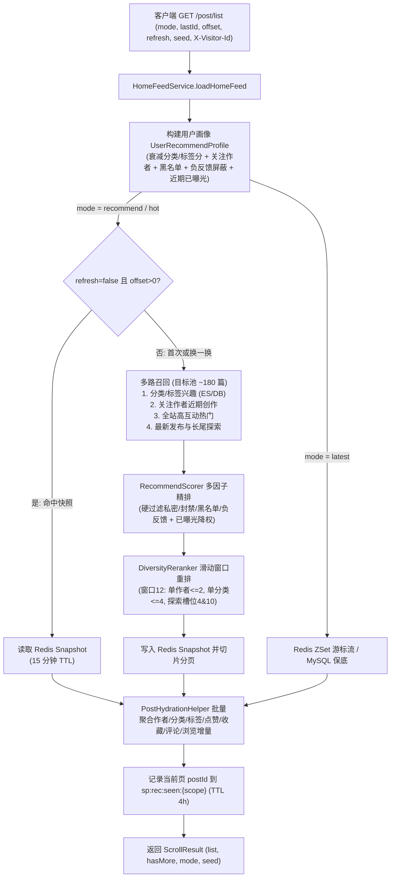

# 首页推荐、标签与分类系统架构文档

本文档说明 Y 社区（Social Platform）重构后的**首页多阶段推荐引擎、双维时间衰减兴趣画像、内容标签体系、分类专栏管理**以及**负反馈闭环与前端交互设计**。

---

## 1. 总体架构与多阶段推荐流水线

首页信息流入口为 `GET /post/list`，由 `HomeFeedService` 统一调度，支持三种浏览模式：

| 模式 (`mode`) | 业务定位 | 排序与召回策略 | 分页与刷新机制 |
|---|---|---|---|
| `recommend`（默认） | 为你推荐（个性化 + 冷启动混排） | 4 路召回（分类/标签兴趣、关注作者、全站高赞热门、最新与探索）→ `RecommendScorer` 精排 → `DiversityReranker` 多样性重排 | Redis 排序快照 (`sp:rec:snap:{scope}:{mode}:{seed}`) + 4 小时已曝光抑制 (`sp:rec:seen:{scope}`)，支持真实「换一换」(`refresh=true`) |
| `hot` | 热门精选 | 全站高互动热度召回 → 天尺度重力时间衰减精排 → 多样性重排 | 同上，支持快照续页与「换一换」 |
| `latest` | 最新发布 | Redis ZSet (`sp:home:post:list`) 实时时间戳倒序，缺失时回源 `home_post` / `post` 表自愈 | 高精度 `(minTime, offset)` 游标循环补齐，过滤黑名单/私密/封禁后返回准确 `hasMore` |

### 1.1 请求链路架构图

---

## 2. 双维兴趣画像与时间衰减模型 (`UserIntersetScoreUtil`)

系统同时维护用户在 **分类 (`user_interest_score`)** 与 **标签 (`user_tag_interest`)** 两个维度上的长期偏好，并通过 Redis 时间戳哈希记录最近交互时间以执行 14 天半衰期指数衰减。

### 2.1 行为信号权重矩阵

| 用户行为 | 触发位置 | 分类分变动 | 标签分变动 | 防刷与同步策略 |
|---|---|---|---|---|
| **浏览帖子** | `PostServiceImpl.getPost` | `+1` | `+2` | Redis `SETNX` 5 分钟同帖同用户冷却期 (`sp:interest:view:{userId}:{postId}`) |
| **发表评论** | `CommentServiceImpl.addComment` | `+5` | `+6` | 同步增减 `post.comment_count` 与 ES `commentCount` |
| **点赞 / 取消点赞** | `LikeServiceImpl.like` | `+/-10` | `+/-12` | 边界钳位 `[0, 1000]` |
| **收藏 / 取消收藏** | `StarServiceImpl.star` | `+/-8` | `+/-10` | 边界钳位 `[0, 1000]` |

### 2.2 分数钳位、半衰期衰减与异步落盘

- **得分边界**：每次增减后均钳位在 `[0, 1000]`，防止单一高频互动挤压其他领域权重；
- **指数时间衰减**：半衰期 $T_{1/2} = 14\text{ 天}$，读取兴趣画像时按距上次交互天数 $\Delta t$ 计算有效兴趣分：
  $$s_{\text{decayed}} = s \times 0.5^{\Delta t / 14}$$
- **Redis 结构**：
  - 分类分 & 最近时间：`sp:user:interest:{userId}`、`sp:user:interest:ts:{userId}`
  - 标签分 & 最近时间：`sp:user:tag:interest:{userId}`、`sp:user:tag:interest:ts:{userId}`
  - 已加载标记：`sp:interest:loaded:{userId}`、`sp:user:tag:interest:loaded:{userId}`
- **异步持久化**：`InterestAsyncWriter` 通过 `@Async("mvcTaskExecutor")` 异步执行 MySQL `INSERT ... ON DUPLICATE KEY UPDATE`。

---

## 3. 精排打分与多样性重排算法

### 3.1 `RecommendScorer` 精排公式

所有候选经过严格可用性过滤（`enabled=true`、`isPrivate=false`、`authorEnabled=true`、非黑名单、`user_recommend_feedback` 屏蔽过滤）后计算分值：

1. **互动质量分 (`qualityScore`)**：
   $$\text{interactions} = 3.0 \times \text{likes} + 4.5 \times \text{stars} + 5.0 \times \text{comments} + 1.2 \times \ln(1 + \text{views})$$
   $$\text{qualityScore} = \min\left(1.0,\ \frac{\ln(1 + \text{interactions})}{\ln(451)}\right)$$
2. **新鲜度分 (`freshnessScore`)**：
   $$\text{freshnessScore} = \frac{1}{1 + (\text{ageDays} / 14)^{0.85}}$$
3. **个性化推荐模式 (`FeedMode.RECOMMEND`)**：
   - 有兴趣/关注画像时：
     $$\text{Score} = 0.28\,A_{\text{cat}} + 0.26\,A_{\text{tag}} + 0.14\,A_{\text{author}} + 0.20\,Q + 0.12\,F + 0.08\,\text{jitter}$$
   - 无画像/未登录冷启动时：
     $$\text{Score} = 0.50\,Q + 0.36\,F + 0.14\,\text{jitter}$$
   - 近期已曝光降权：若 `postId` 命中 4 小时 `seenSet`，则 `Score -= 1.0`（在「换一换」后自动退至未看内容之后，但未看不足时仍可兜底）。
4. **热门精选模式 (`FeedMode.HOT`)**：
   $$\text{HotScore} = \frac{\text{interactions} + 1}{(\text{ageDays} + 2)^{1.2}}$$
   同受已曝光折减系数 `0.65` 与微量确定性扰动影响。

### 3.2 `DiversityReranker` 滑动窗口重排

默认窗口 `DEFAULT_WINDOW_SIZE = 12`：
- **未曝光优先**：先重排 `unseen` 桶，再重排 `seen` 桶；
- **频次与连续性约束**：单窗口内同作者最多 `2` 篇（`MAX_AUTHOR_PER_WINDOW = 2`），尽量避免同作者连续出现；单窗口同分类最多 `4` 篇（`MAX_CATEGORY_PER_WINDOW = 4`）；
- **探索槽位保留**：窗口索引 `4`（第 5 条）和 `10`（第 11 条）优先分配给非用户前 2 大主导分类且 `qualityScore >= 0.30` 的跨界探索帖，并标注推荐理由 `拓展发现`；常规槽位优先消费非探索候选，避免提前消耗稀缺探索内容。

---

## 4. 负反馈闭环与匿名刷新

- **负反馈接口**（需登录）：
  - `POST /recommend/feedback`：提交 `{ targetType: "POST" | "CATEGORY" | "TAG" | "AUTHOR", targetId, reason }`
  - `DELETE /recommend/feedback?targetType=...&targetId=...`：撤销屏蔽（支持前端点击「撤销」即时恢复）
- **持久化与缓存**：写入 MySQL `user_recommend_feedback` 并同步刷新 Redis Hash `sp:rec:feedback:{userId}`（TTL 7 天），同时失效当前推荐快照，确保下一次刷新立即生效。
- **访客去重**：未登录游客通过前端持久化 `sp_visitor_id` 携带 `X-Visitor-Id` 请求头，独立拥有 `sp:rec:seen:anon:{visitorId}` 已曝光窗口，未登录也可稳定体验真实「换一换」。

---

## 5. 分类与标签体系设计

### 5.1 核心数据表与增量迁移

完整初始化脚本位于 `src/main/resources/social_platform.sql`，存量库幂等升级脚本位于 `docs/sql/upgrade-20261113.sql`。

| 表名 | 核心字段与用途 |
|---|---|
| `category` | 新增 `description`、`icon`、`color`、`sort_order`、`enabled` 及 `uk_category_name` |
| `post` | 新增冗余字段 `comment_count`（点赞/收藏已有聚合计数，`comment_count` 由评论增删维护并同步至 ES）及 `idx_category_enabled` |
| `user_interest_score` | 新增 `update_time` 记录最近分类交互时间以计算半衰期衰减 |
| `tag` | `id, name (唯一规范名), slug, category_id, use_count, is_hot, create_time, update_time` |
| `post_tag` | `post_id, tag_id` 多对多关联，`uk_post_tag (post_id, tag_id)` + 反向索引 `idx_tag_post (tag_id, post_id)` |
| `user_tag_interest` | `user_id, tag_id, score, update_time`，`uk_user_tag (user_id, tag_id)` |
| `user_recommend_feedback` | `user_id, target_type, target_id, reason, create_time`，`uk_user_target` |

### 5.2 分类、标签与搜索 API 清单

| 方法与路径 | 权限 | 说明 |
|---|---|---|
| `GET /category` | 公开 | 获取已启用分类列表 `List<CategoryVO>`（按 `sortOrder` 排序，含 `postCount` 与 `hotTags`） |
| `GET /category/{id}` | 公开 | 获取单个分类详情与统计 |
| `GET /category/{id}/tags` | 公开 | 获取指定分类下的热门标签（支持 `limit`） |
| `GET /admin/category` | `ADMIN` | 管理端全部分类列表（含禁用分类） |
| `POST /admin/category` / `PUT /admin/category` | `ADMIN` | 新增 / 编辑分类名称、图标、配色、简介、排序与启用状态 |
| `PUT /admin/category/{id}/toggle` | `ADMIN` | 启用/禁用指定分类（自动失效 `CATEGORY_VO_LIST_KEY` 缓存） |
| `GET /tag/hot` | 公开 | 获取全站或指定分类热门标签 |
| `GET /tag/search` | 公开 | 发帖标签输入自动联想检索 |
| `GET /tag/posts` | 公开 | 按 `tagId` 或 `tagName` 分页检索公开帖子 |
| `GET /user/list/post` | 公开 | 帖子检索新增可选 `tagId` 过滤，ES 关键词同时匹配标题、正文与 `tagNames`（权重 `2.0`） |
| `POST /post` | 登录 | `PostDTO` 新增 `tags`（最多 5 个，自动去 `#`、去重、按需建表并更新 `use_count` 与 ES 索引） |
